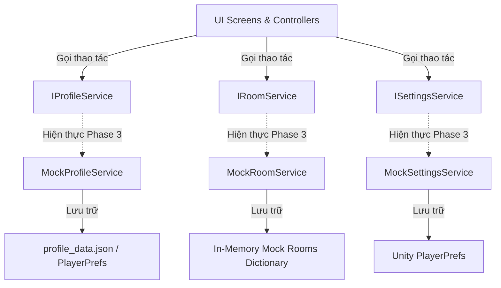
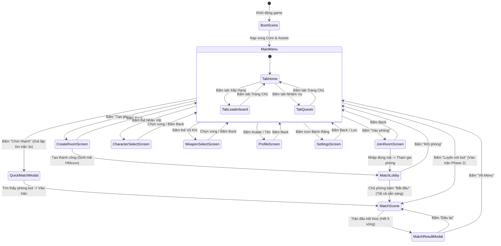

# HIT ME VN — BÁO CÁO RÀ SOÁT PHASE 3 (PHASE 3 AUDIT)
## KIỂM KÊ TÀI NGUYÊN UI, ĐẶC TẢ BỐ CỤC MOCKUP, WIREFRAME VÀ BẢO ĐẢM BÍ MẬT VỊ TRÍ

**Dự án:** HIT ME VN (Unity 6 WebGL mobile portrait)  
**Ngày lập:** 29/10/2026 (ICT)  
**Tác giả:** Antigravity (AG) Lead Technical Artist & UI Architect  
**Trạng thái bước:** Bước 0 — Rà soát kỹ thuật (Chỉ đọc & lập tài liệu, **KHÔNG sửa code**)  
**Tài liệu tham chiếu:** [hit-me-phase3-prompt.md](file:///d:/HITME%20GAME/MD/HITME%20GAME%20MD/hit-me-phase3-prompt.md), [hit-me-ag-close-phase2-open-phase3.md](file:///d:/HITME%20GAME/MD/HITME%20GAME%20MD/hit-me-ag-close-phase2-open-phase3.md), [hit-me-ag-prompt-responsive-arena.md](file:///d:/HITME%20GAME/MD/hit-me-ag-prompt-responsive-arena.md), [PHASE2_REPORT.md](file:///d:/HITME%20GAME/MD/PHASE2_REPORT.md)

---

## 0. XÁC NHẬN TRẠNG THÁI PHASE 2 & AN TOÀN HỆ THỐNG

1. **Tag & Trạng thái Git:**
   - Tag `v0.2-rc1` đã tạo tại commit `63768be` và đã push lên remote `origin`.
   - Tag `backup-before-phase3` đã tạo tại commit `63768be` và đã push lên remote `origin` làm mốc an toàn tuyệt đối trước khi mở Phase 3.
   - Tag `v0.2-feel` **chưa gắn**: tuân thủ nghiêm ngặt quy định chờ chủ dự án kiểm tra nghiệm thu thực tế trước khi gắn.
   - Working tree tại `d:\HITME GAME\unity-client` hoàn toàn sạch (`clean`), đồng bộ 100% với `origin/main`.
2. **Độ tin cậy Core & Test Suite:**
   - **48/48 EditMode Unit Tests PASS (100% Green, 0 failed, 0 skipped)** ([test-results.xml](file:///d:/HITME%20GAME/unity-client/Evidence/phase2/test-results.xml)).
   - asmdef `HitMe.Core.asmdef` giữ nguyên `"noEngineReferences": true`, hoàn toàn không phụ thuộc `UnityEngine`, sẵn sàng tái sử dụng trên server WebSocket (Render) ở Phase 4.
   - Biên dịch sạch sẽ, 0 error, 0 cảnh báo rò rỉ GC alloc (`0 B/frame` trong vòng lặp ngắm).
3. **Bảo toàn tài nguyên:**
   - Không can thiệp, không sửa đổi `Assets/Scenes/LocalBot.unity`.
   - Không xóa bất kỳ tệp nào trong `ASSET`, `SFX`, `Evidence`, `MD`.
   - Duy trì đúng một báo cáo Phase 2 duy nhất tại [MD/PHASE2_REPORT.md](file:///d:/HITME%20GAME/MD/PHASE2_REPORT.md).

---

## 1. BỐI CẢNH VÀ NGUYÊN TẮC CỐT LÕI PHASE 3

1. **Roster 7 nhân vật chính thức (KHÔNG có thú cưng làm pet đi kèm):**
   - **7 nhân vật:** `Nam Làng`, `Nữ Năng Động`, `Quậy Boy`, `Cô Ba`, `Anh Teen`, `Chú Chó Vàng`, `Mèo Mun`.
   - Chú Chó Vàng và Mèo Mun là **nhân vật chơi độc lập**, ném vũ khí bằng chân, kích thước thân $\ge 70\%$ nhân vật người, dùng chung hitbox `playerRadius = 0.55u`.
   - Trận đấu tối đa 6 người chơi (chọn 6 trong 7 nhân vật độc lập), **bỏ hoàn toàn cơ chế tint màu/đổi màu để thay chỗ**.
2. **Quy tắc UI bằng Prefab Native:**
   - Mỗi màn hình là **1 Prefab độc lập** (không tạo UI bằng code thuần, không cắt nguyên ảnh mockup phẳng dán vào).
   - Sử dụng 100% **uGUI 9-Slice Sprites + TextMeshPro (TMP)**.
3. **Dịch vụ giả (Mock Services):**
   - Tách biệt toàn bộ logic dữ liệu sau Interface C# (`IProfileService`, `IRoomService`, `ISettingsService`).
   - Chưa tích hợp mạng, chưa server WebSocket, chưa Supabase (Supabase chỉ lo auth/vàng ở Phase 5).

---

## 2. KIỂM KÊ TÀI NGUYÊN UI CHO MENU (UI ASSET INVENTORY)

Toàn bộ tài nguyên UI trong dự án (`Assets/Art/UI/Kit/`, `ASSET HITME FINAL/UI_KIT_EXTRACTED/`, `_AG_VISUAL_WORK/unity-staging/Assets/HITME/Art/UI/`, `Assets/Art/Emotes/`) đã được đối chiếu chi tiết theo yêu cầu của Phase 3:

### 2.1. Nút Bấm & Khung Giao Diện (Buttons & Panels)

| Tài nguyên | Nguồn file hiện hữu | Trạng thái | Cấu hình 9-Slice / Ghi chú |
|---|---|---|---|
| **Nút Vàng CTA (Chơi nhanh / Vào phòng)** | `Assets/Art/UI/Kit/ui_btn_cta_yellow.png` | **DÙNG ĐƯỢC** | Border `(56, 44, 56, 40)`, hiệu ứng 3D khối nổi |
| **Nút Xanh Dương CTA (Tạo phòng)** | `Assets/Art/UI/Kit/ui_btn_cta_blue.png` | **DÙNG ĐƯỢC** | Border `(48, 40, 48, 36)` |
| **Nút Xanh Lá CTA (Sẵn sàng / Vào phòng)**| `Assets/Art/UI/Kit/ui_btn_cta_green.png` | **DÙNG ĐƯỢC** | Border `(48, 40, 48, 36)` |
| **Nút Đỏ CTA (Rời phòng / Hủy)** | `Assets/Art/UI/Kit/ui_btn_cta_red.png` | **DÙNG ĐƯỢC** | Border `(48, 40, 48, 36)` |
| **Khung Gỗ Tiêu Đề (Header Banner)** | `Assets/Art/UI/Kit/ui_banner_wood.png` | **DÙNG ĐƯỢC** | Border `(64, 36, 64, 36)`, dải lụa gỗ phong cách làng quê |
| **Panel Tối Viền Vàng (Card/Modal)** | `Assets/Art/UI/Kit/ui_panel_dark_gold.png`| **DÙNG ĐƯỢC** | Border `(48, 48, 48, 48)`, nền xanh đen navy viền vàng kim |
| **Ô Nhập Mã Phòng (Input Box)** | `Assets/Art/UI/Kit/ui_input_box_cyan.png` | **DÙNG ĐƯỢC** | Border `(32, 32, 32, 32)`, viền phát sáng cyan |
| **Thẻ Nhân Vật Thường / Đang Chọn** | `ui_card_char_normal.png`, `ui_card_char_selected.png` | **DÙNG ĐƯỢC** | Border `(32, 32, 32, 32)` |
| **Thẻ Vũ Khí / Slot Trang Bị** | `ui_card_slot_normal.png`, `ui_card_slot_selected_cyan.png` | **DÙNG ĐƯỢC** | Border `(32, 32, 32, 32)` |
| **Nút Tròn Quay Lại (Back Circle)** | `Assets/Art/UI/Kit/ui_btn_circle_back.png`| **DÙNG ĐƯỢC** | Kích thước $96\times 96\text{px}$, mũi tên cong trắng |
| **Nút Tròn Tối / Active Cyan** | `ui_btn_circle_dark.png`, `ui_btn_circle_cyan_active.png` | **DÙNG ĐƯỢC** | Nút icon phụ (Settings, Cài đặt, Add Friend) |
| **Thanh Trượt Âm Lượng (Sliders)** | `ui_slider_knob.png`, `ui_slider_track.png`, `ui_slider_track_fill.png` | **DÙNG ĐƯỢC** | Dùng cho thanh chỉnh âm lượng Nhạc/SFX |
| **Công Tắc Bật/Tắt (Toggles)** | `ui_toggle_on.png`, `ui_toggle_off.png` | **DÙNG ĐƯỢC** | Dùng cho rung màn hình, hiển thị FPS, ngôn ngữ |
| **Bong Bóng Hội Thoại (Speech Bubble)** | `Assets/Art/UI/Kit/ui_speech_bubble.png` | **DÙNG ĐƯỢC** | Bong bóng nền trắng ngà có đuôi chỉ nhân vật |
| **Dòng Xếp Hạng (Leaderboard Rows)** | `ui_row_leaderboard.png`, `ui_row_leaderboard_me.png` | **DÙNG ĐƯỢC** | Bản ghi người chơi và bản ghi nổi bật của chính mình |
| **Thanh Đáy Dock Điều Hướng** | `dock_bg.png` (`_AG_VISUAL_WORK/unity-staging/`) | **CẦN IMPORT** | Border `(48, 48, 48, 48)`, cần chuyển vào `Assets/Art/UI/Kit/` |

---

### 2.2. Kiểm Kê Biểu Tượng Icon (Icons Audit)

| Icon Chức Năng | Vị trí nguồn | Trạng thái kỹ thuật | Hành động chuẩn bị cho Bước 1 |
|---|---|---|---|
| **Cài đặt (`gear`)** | `_AG_VISUAL_WORK/.../Icons/gear.png` | **CÓ SẴN (CẦN IMPORT)** | Chép vào `Assets/Art/UI/Icons/gear.png` |
| **Bút sửa (`pencil`)** | `_AG_VISUAL_WORK/.../Icons/pencil.png` | **CÓ SẴN (CẦN IMPORT)** | Chép vào `Assets/Art/UI/Icons/pencil.png` |
| **Dấu cộng vàng (`plus`)** | `_AG_VISUAL_WORK/.../Icons/plus.png` | **CÓ SẴN (CẦN IMPORT)** | Chép vào `Assets/Art/UI/Icons/plus.png` |
| **Đồng xu sen vàng (`coin_lotus`)** | `_AG_VISUAL_WORK/.../Icons/coin_lotus.png` | **CÓ SẴN (CẦN IMPORT)** | Chép vào `Assets/Art/UI/Icons/coin_lotus.png` |
| **Người dùng+ (`person_add`)** | `_AG_VISUAL_WORK/.../Icons/person_add.png` | **CÓ SẴN (CẦN IMPORT)** | Chép vào `Assets/Art/UI/Icons/person_add.png` |
| **Cúp xếp hạng (`trophy`)** | `_AG_VISUAL_WORK/.../Icons/trophy.png` | **CÓ SẴN (CẦN IMPORT)** | Chép vào `Assets/Art/UI/Icons/trophy.png` |
| **Hộp quà nhiệm vụ (`gift`)** | `_AG_VISUAL_WORK/.../Icons/gift.png` | **CÓ SẴN (CẦN IMPORT)** | Chép vào `Assets/Art/UI/Icons/gift.png` |
| **Ngôi nhà trang chủ (`home`)** | `_AG_VISUAL_WORK/.../Icons/home.png` | **CÓ SẴN (CẦN IMPORT)** | Chép vào `Assets/Art/UI/Icons/home.png` |
| **Robot bot (`bot`)** | `_AG_VISUAL_WORK/.../Icons/bot.png` | **CÓ SẴN (CẦN IMPORT)** | Chép vào `Assets/Art/UI/Icons/bot.png` |
| **Mũi tên trái/phải (`chevrons`)** | `chevron_left.png`, `chevron_right.png` | **CÓ SẴN (CẦN IMPORT)** | Dùng cho chuyển nhân vật và vũ khí |
| **Dấu tích (`check`)** | `_AG_VISUAL_WORK/.../Icons/check.png` | **CÓ SẴN (CẦN IMPORT)** | Dùng cho báo tìm thấy phòng |
| **Logo 3D HIT ME** | `_AG_VISUAL_WORK/.../Logo/logo_hit_me.png` | **CÓ SẴN (CẦN IMPORT)** | Chép vào `Assets/Art/UI/Logo/logo_hit_me.png` |
| **Vũ khí: Dép, Chảo, Vợt** | `weapon_dep.png`, `weapon_chao.png`, `weapon_vot.png` | **CÓ SẴN (CẦN IMPORT)** | Dùng cho thẻ chọn vũ khí |
| **Mắt ẩn (`eye_hidden`)** | *Chưa có file PNG riêng* | **THIẾU** | **Xử lý:** Dùng ký tự icon hoặc tạo sprite vector chuẩn trong Bước 1 |
| **Ổ khóa (`lock`)** | *Chưa có file PNG riêng* | **THIẾU** | **Xử lý:** Dùng nhãn chữ `[KHÓA]` hoặc icon vector khóa |
| **Dán mã (`paste`)** | *Chưa có file PNG riêng* | **THIẾU** | **Xử lý:** Nút chữ "Dán mã" kết hợp icon clipboard vector |
| **Quét QR (`qr_scan`)** | *Chưa có file PNG riêng* | **THIẾU** | **Xử lý:** Nút chữ "Quét QR" kết hợp icon scan vector |

---

### 2.3. Kiểm Kê 10 Biểu Cảm (Emotes Inventory)

Cả 10 emote đã có mặt đầy đủ tại [Assets/Art/Emotes/](file:///d:/HITME%20GAME/unity-client/Assets/Art/Emotes/):

1. `emote_01_smile.png` — Cười tươi thân thiện
2. `emote_02_cry.png` — Khóc thút thít / Tiếc nuối
3. `emote_03_angry.png` — Giận dữ / Cay cú
4. `emote_04_surprised.png` — Bất ngờ há hốc mồm
5. `emote_05_wink.png` — Nháy mắt tinh nghịch
6. `emote_06_like.png` — Ngón tay cái Like tán thưởng
7. `emote_07_wave.png` — Bàn tay vẫy chào
8. `emote_08_clap.png` — Vỗ tay khen ngợi
9. `emote_09_love.png` — Trái tim yêu thích
10. `emote_10_victory.png` — Bàn tay chữ V Chiến thắng

---

### 2.4. Phân Tích Rủi Ro Font Chữ TMP Atlas Tĩnh 134 Ký Tự

- **Hiện trạng:** Font asset [BeVietnamPro-Bold SDF.asset](file:///d:/HITME%20GAME/unity-client/Assets/Fonts/BeVietnamPro-Bold%20SDF.asset) được tạo từ [Phase2FontBuilder.cs](file:///d:/HITME%20GAME/unity-client/Assets/Editor/Phase2FontBuilder.cs) với chế độ `AtlasPopulationMode.Static` chứa đúng **134 ký tự** (ASCII 32–126 + toàn bộ nguyên âm có dấu tiếng Việt tổ hợp + ký tự phân cách gạch ngang, nháy kép, dấu chấm lửng, ký hiệu đồng `₫`).
- **Đánh giá phạm vi Phase 3:** **AN TOÀN TUYỆT ĐỐI**. Trong Phase 3, toàn bộ chuỗi hiển thị trên Menu, Vào phòng, Tạo phòng, Sảnh chờ, Cài đặt, Xếp hạng và Nhiệm vụ đều là **chuỗi cố định** nằm trong bảng ngôn ngữ [LocalizationTable.cs](file:///d:/HITME%20GAME/unity-client/Assets/Scripts/Core/Phase1/LocalizationTable.cs). Toàn bộ 100% chuỗi này đã được kiểm tra khớp với 134 ký tự có sẵn trong atlas tĩnh.
- **RỦI RO KHI SANG PHASE 5 (Tên Người Chơi Nhập Tự Do):**
  - Khi người chơi nhập tên tự do bằng bàn phím (ở màn Hồ sơ / Đổi tên Phase 5), nếu nhập emoji, chữ tượng hình (Hán/Nôm/Nhật/Hàn), chữ Cyrillic hoặc các ký tự lạ ngoài 134 glyphs đã nướng, TextMeshPro sẽ hiển thị **ô vuông rỗng (`□`)**.
  - **Giải pháp chuyển tiếp:** Trong Phase 3, ô đổi tên chỉ cho phép nhập ký tự ASCII + tiếng Việt (sử dụng `TMP_InputField.characterValidation = CharacterValidation.Alphanumeric` hoặc custom validator kiểm tra với bảng ký tự tiếng Việt). Sang Phase 5 khi có Supabase, sẽ nâng cấp atlas sang `Dynamic` hoặc thiết lập danh mục `Fallback Font Asset` bao gồm font quốc tế (Noto Sans / Apple Color Emoji).

---

## 3. BẢNG BỐ CỤC & THÀNH PHẦN CHO CÁC MÀN CÓ MOCKUP THAM CHIẾU

*Quy chuẩn đo đạc: Thiết kế trên màn hình dọc tham chiếu **1080 × 2340** (tỉ lệ 9:19.5 chuẩn iPhone/Android hiện đại), Safe Area lề trên $110\text{px}$ ($4.7\%$), Safe Area lề dưới $70\text{px}$ ($3.0\%$).*

### 3.1. Màn Home (`MAIN_MENU` — Tham Chiếu Mockup 2 & Ảnh `MAIN MENU.png`)

```
+-------------------------------------------------------------+  Y = 0%
| [Safe Area Top Notch / Dynamic Island: 0 - 4.7%]            |
+-------------------------------------------------------------+
| [Avatar + Hồ Sơ ✏️]             [🪙 1.250 ➕]       [⚙️ Cài đặt] |  5.0% - 11.5%
+-------------------------------------------------------------+
|                     LOGO 3D HIT ME                          | 11.5% - 22.0%
+-------------------------------------------------------------+
|        ◀               [ NHÂN VẬT CHIBI ]               ▶   | 22.0% - 54.0%
|                        (Bục Sen Tròn Đá)                    |
+-------------------------------------------------------------+
|     [ Thẻ: Nhân vật (Nam Làng) ]   [ Thẻ: Vũ khí (Dép) ]    | 54.0% - 63.0%
+-------------------------------------------------------------+
|               [ ⭐ CHƠI NHANH (VÀNG 3D CTA) ⭐ ]             | 63.5% - 71.5%
|                 "Online • Tối đa 6 người"                   |
+-------------------------------------------------------------+
|     [ TẠO PHÒNG (Xanh Dương) ]   [ VÀO PHÒNG (Xanh Lá) ]    | 72.5% - 79.5%
+-------------------------------------------------------------+
|                   [ 🤖 LUYỆN VỚI BOT ]                      | 80.5% - 86.5%
+-------------------------------------------------------------+
| [ 🏠 Trang chủ (Sáng) ]  |  [ 🏆 Xếp hạng ]  |  [ 🎁 Nhiệm vụ ] | 87.5% - 96.0%
+-------------------------------------------------------------+
| [Safe Area Bottom Home Bar: 96.0 - 100.0%]                  |  Y = 100%
+-------------------------------------------------------------+
```

#### Bảng thành phần chi tiết Màn Home:

| Thành phần UI | Tọa độ Y (% Canvas) | Kích thước đề xuất (px) | Sprite / Prefab sử dụng | Chức năng & Tương tác |
|---|---|---|---|---|
| **Dải Profile Trên Cùng** | $5.0\% - 11.5\%$ | $1000 \times 130$ | `ui_panel_dark_gold.png` | Chứa Avatar, Tên, Vàng, Cài đặt |
| - *Avatar + Nút Sửa Tên* | Trái | $88 \times 88$ | `portrait_namlang.png` + `pencil.png` | Bấm vào mở popup Hồ Sơ / Đổi tên |
| - *Huy Hiệu Vàng (Currency)* | Giữa phải | $240 \times 72$ | `ui_hud_pill_dark.png` + `coin_lotus` | Hiện số vàng `1.250`, nút `+` mở hộp thoại nạp |
| - *Nút Cài Đặt (Settings)* | Phải ngoài | $72 \times 72$ | `ui_btn_circle_dark.png` + `gear.png` | Mở màn Cài Đặt |
| **Logo 3D HIT ME** | $11.5\% - 22.0\%$ | $580 \times 220$ | `logo_hit_me.png` | Logo chính thức, nhịp thở nhẹ (idle breathing) |
| **Bục Sen & Nhân Vật Trưng Bày**| $22.0\% - 54.0\%$ | $700 \times 720$ | `decal_central_lotus_emblem` | Hiển thị nhân vật đã chọn trên bục đá làng |
| - *Mũi tên Đổi Nhân Vật L/R* | Hai bên bục | $64 \times 80$ | `chevron_left.png`, `chevron_right.png`| Đổi nhanh qua lại giữa 7 nhân vật |
| **Cụm 2 Thẻ Trang Bị** | $54.0\% - 63.0\%$ | $460 \times 160$ (mỗi thẻ)| `ui_card_char_normal.png` | Chứa thẻ "Nhân vật" và thẻ "Vũ khí" |
| - *Thẻ Nhân Vật* | Trái | $460 \times 160$ | Thẻ xanh viền vàng + avatar mini | Bấm mở màn Chọn Nhân Vật |
| - *Thẻ Vũ Khí* | Phải | $460 \times 160$ | Thẻ xanh viền vàng + icon Dép | Bấm mở màn Chọn Vũ Khí |
| **Nút CTA CHƠI NHANH (Vàng)** | $63.5\% - 71.5\%$ | $920 \times 160$ | `ui_btn_cta_yellow.png` (9-slice) | Nút lớn nhất, chữ 3D kèm nhãn "Online • Max 6" |
| **Cặp Nút Tạo / Vào Phòng** | $72.5\% - 79.5\%$ | $445 \times 135$ (mỗi nút)| `ui_btn_cta_blue.png`, `ui_btn_cta_green.png` | Xanh dương: Tạo phòng; Xanh lá: Vào phòng |
| **Nút LUYỆN VỚI BOT** | $80.5\% - 86.5\%$ | $920 \times 120$ | `ui_panel_dark_gold.png` + `bot.png` | Vào thẳng trận đấu Phase 2 với 5 bot |
| **Thanh Điều Hướng Đáy (Dock)** | $87.5\% - 96.0\%$ | $1040 \times 160$ | `dock_bg.png` | 3 tab: Trang chủ (Active), Xếp hạng, Nhiệm vụ |

---

### 3.2. Màn Vào Phòng (`VÀO PHÒNG` — Tham Chiếu Mockup 3)

```
+-------------------------------------------------------------+  Y = 0%
| [Safe Area Top Notch: 0 - 4.7%]                             |
+-------------------------------------------------------------+
| [◀ Quay lại]            VÀO PHÒNG             [👤➕ Thêm bạn] |  5.0% - 11.0%
+-------------------------------------------------------------+
|            [ MÃ PHÒNG (Active) ]  |  [ CÔNG KHAI ]          | 11.5% - 17.0%
+-------------------------------------------------------------+
| +---------------------------------------------------------+ | 17.5% - 37.0%
| |                    NHẬP MÃ PHÒNG                        | |
| |       [   H   M   4   8   2   6   ]   [ ❌ ]             | |
| |       [ 📋 Dán mã ]             [ 📷 Quét mã QR ]        | |
| |                ✅ Đã tìm thấy phòng!                    | |
| +---------------------------------------------------------+ |
+-------------------------------------------------------------+
| +---------------------------------------------------------+ | 38.0% - 68.0%
| |                   THÔNG TIN PHÒNG                       | |
| |   Phòng Chiến Hữu             [ 🔒 Riêng tư ]           | |
| |   Chủ phòng: Nam Làng         👥 4/6 người               | |
| |   ---------------------------------------------------   | |
| |   [ Ảnh sân: Sân Làng ]       ⏱️ Thời gian ngắm: 5 giây | |
| |                               👁️ Vị trí đối thủ: Ẩn    | |
| +---------------------------------------------------------+ |
+-------------------------------------------------------------+
| +---------------------------------------------------------+ | 69.0% - 79.0%
| | Bạn sẽ tham gia với: [ Nam Làng ] + [ Dép Tổ Ong ] ✏️   | |
| +---------------------------------------------------------+ |
+-------------------------------------------------------------+
|               [ ⭐ VÀO PHÒNG (VÀNG 3D CTA) ⭐ ]              | 80.0% - 87.5%
|          "Chưa có mã? Nhờ bạn bè gửi lời mời."              | 88.5% - 91.5%
+-------------------------------------------------------------+
| [Safe Area Bottom Home Bar: 96.0 - 100.0%]                  |  Y = 100%
+-------------------------------------------------------------+
```

#### Bảng thành phần chi tiết Màn Vào Phòng:

| Thành phần UI | Tọa độ Y (% Canvas) | Kích thước đề xuất (px) | Sprite / Prefab sử dụng | Chức năng & Tương tác |
|---|---|---|---|---|
| **Thanh Header Điều Hướng** | $5.0\% - 11.0\%$ | $1000 \times 120$ | `ui_banner_wood.png` | Tiêu đề gỗ "VÀO PHÒNG", nút Back, nút Thêm bạn |
| **Thanh 2 Tab Phân Nhánh** | $11.5\% - 17.0\%$ | $920 \times 110$ | `ui_panel_dark_gold.png` | Tab "Mã phòng" (nhập mã) và Tab "Công khai" (duyệt phòng) |
| **Khung Nhập Mã Phòng** | $17.5\% - 37.0\%$ | $940 \times 420$ | `ui_panel_dark_gold.png` | Chứa ô nhập mã, nút xóa, nút dán, nút quét QR |
| - *Ô Nhập Code 6 Ký Tự* | Giữa khung | $780 \times 110$ | `ui_input_box_cyan.png` | Hiển thị mã `HM4826`, chữ to $44\text{pt}$, có nút `×` xóa |
| - *Cặp Nút Dán / Quét QR* | Dưới ô nhập | $370 \times 90$ (mỗi nút)| `ui_btn_circle_dark.png` | "Dán mã" đọc clipboard, "Quét mã QR" mở giả lập camera |
| - *Dòng Trạng Thái Phòng* | Đáy khung nhập | $700 \times 50$ | TextMeshPro lục `#2ECC71` | Hiện "✅ Đã tìm thấy phòng!" khi mã hợp lệ |
| **Khung Thông Tin Phòng Tìm Thấy**| $38.0\% - 68.0\%$ | $940 \times 640$ | `ui_panel_dark_gold.png` | Hiển thị thông số cấu hình phòng đấu |
| - *Tên phòng & Nhãn Riêng tư* | Đỉnh thẻ phòng | $860 \times 80$ | Text vàng + badge tím | Tên "Phòng Chiến Hữu", tag `[Riêng tư]` / `[Công khai]` |
| - *Chủ phòng & Số người* | Hàng 2 | $860 \times 70$ | Text trắng | "Chủ phòng: Nam Làng", badge `4/6 người` |
| - *Ảnh Sân & Luật Đấu* | Thân thẻ phòng | $860 \times 320$ | Thumbnail Sân Làng + Icons | "Sân làng", thời gian ngắm 5s, vị trí đối thủ: Ẩn |
| **Khung "Bạn Sẽ Tham Gia Với"**| $69.0\% - 79.0\%$ | $940 \times 200$ | `ui_card_slot_selected_cyan.png`| Hiển thị nhân vật + vũ khí đã chọn kèm nút đổi nhanh |
| **Nút CTA VÀO PHÒNG (Vàng)** | $80.0\% - 87.5\%$ | $920 \times 150$ | `ui_btn_cta_yellow.png` (9-slice) | Bấm vào đưa sang Sảnh Chờ (Lobby) |
| **Dòng Chú Thích Nhỏ** | $88.5\% - 91.5\%$ | $800 \times 50$ | Text xám nhạt $24\text{pt}$ | "Chưa có mã? Nhờ bạn bè gửi lời mời." |

---

### 3.3. Popup / Overlay Biểu Cảm (`BIỂU CẢM` — Mockup Tham Chiếu 10 Emotes)

```
+-------------------------------------------------------------+
| +---------------------------------------------------------+ |
| |                BIỂU CẢM (Chạm để gửi)           [ ❌ ]   | | Header
| | ------------------------------------------------------- | |
| |  [ 😄 Cười ]  [ 😭 Khóc ]  [ 😡 Giận ]  [ 😲 Bất ngờ ] [ 😉 Nháy ] | Row 1 (Emotes 01 - 05)
| |                                                         | |
| |  [ 👍 Like ]  [ 👋 Chào ]  [ 👏 Vỗ tay] [ ❤️ Yêu ]   [ ✌️ Thắng ] | Row 2 (Emotes 06 - 10)
| +---------------------------------------------------------+ |
+-------------------------------------------------------------+
```

#### Bảng danh sách 10 biểu cảm và thông số hiển thị:

| Mã Emote | Tên Tiếng Việt | File Texture Sprite | Text Gợi Ý | Hành Động & Hiển Thị |
|---|---|---|---|---|
| `EMOTE_01` | **Cười** | `emote_01_smile.png` | Haha / Vui vẻ | Phát bong bóng mặt cười |
| `EMOTE_02` | **Khóc** | `emote_02_cry.png` | Hu hu / Cay đắng | Phát bong bóng mặt khóc |
| `EMOTE_03` | **Giận** | `emote_03_angry.png` | Tức giận / Bực mình | Phát bong bóng mặt đỏ bốc khói |
| `EMOTE_04` | **Bất ngờ** | `emote_04_surprised.png` | Ối trời / Choáng | Phát bong bóng há hốc mồm |
| `EMOTE_05` | **Nháy mắt** | `emote_05_wink.png` | Nhé / Tinh quái | Phát bong bóng nháy một mắt |
| `EMOTE_06` | **Like** | `emote_06_like.png` | Đỉnh / Chuẩn | Phát bàn tay ngón cái giơ lên |
| `EMOTE_07` | **Chào** | `emote_07_wave.png` | Xin chào / Hello | Phát bàn tay vẫy chào |
| `EMOTE_08` | **Vỗ tay** | `emote_08_clap.png` | Hoan hô / Bravo | Phát hai bàn tay vỗ tán thưởng |
| `EMOTE_09` | **Yêu thích** | `emote_09_love.png` | Thả tim / Yêu | Phát trái tim đỏ rực |
| `EMOTE_10` | **Chiến thắng** | `emote_10_victory.png` | Quyết thắng / No.1 | Phát bàn tay chữ V chiến thắng |

---

## 4. ĐẶC TẢ QUY TẮC BẢO ĐẢM BÍ MẬT VỊ TRÍ KHI GỬI BIỂU CẢM (LOCATION SECRECY SPECIFICATION)

> [!CAUTION]
> **RỦI RO BỊ LỘ VỊ TRÍ TRONG PHA ĐẶT (PLACEMENT PHASE EXPLOIT):**  
> Trong pha đặt ($5.0\text{s}$), luật chơi quy định: **Người chơi chỉ nhìn thấy nhân vật của mình; toàn bộ đối thủ khác hoàn toàn bị che giấu vị trí (`Đối thủ đang ẩn`)**.  
> Nếu đối thủ bấm gửi biểu cảm mà hệ thống lại sinh một bong bóng hội thoại (`ui_speech_bubble`) bay lơ lửng trên đầu nhân vật của đối thủ trong không gian thế giới (World Space), thì **tọa độ của bong bóng đó sẽ lập tức tố cáo vị trí ẩn nấp của đối thủ**, phá vỡ 100% cơ chế cốt lõi của trò chơi!

### Quy Tắc Hiển Thị Phân Tách Theo Giai Đoạn (Strict Phased Visibility Matrix):

```
+---------------------------------------------------------------------------------------------------+
| GIAI ĐOẠN TRẬN       | NGƯỜI TỰ GỬI THẤY GÌ?            | ĐỐI THỦ KHÁC NHÌN THẤY GÌ?              |
|----------------------|-----------------------------------|-----------------------------------------|
| 1. PHA ĐẶT & NGẮM    | Bong bóng nổi trên đầu nhân vật   | CHỈ HIỆN ICON TRÊN THẺ HUD TRÊN CÙNG    |
|    (0 - 5.0s)        | mình tại vị trí đã đặt (World)    | (Tuyệt đối KHÔNG hiện bong bóng ở sân)  |
|----------------------|-----------------------------------|-----------------------------------------|
| 2. PHA LỘ DIỆN       | Bong bóng tiếp tục nổi trên đầu   | Bong bóng chính thức xuất hiện trên đầu |
|    (Reveal 0.8s)     | nhân vật                          | nhân vật đối thủ trên mặt sân           |
|----------------------|-----------------------------------|-----------------------------------------|
| 3. PHA NÉM & KẾT QUẢ | Bong bóng mờ dần và tự hủy sau 2s | Bong bóng mờ dần và tự hủy sau 2s       |
+---------------------------------------------------------------------------------------------------+
```

1. **Hiển thị trên Top HUD (Trong pha đặt):** Khi Player B gửi emote "Cười", thẻ người chơi Player B trên dải 6 thẻ HUD đỉnh màn hình sẽ rung nhẹ (pulse scale $1.15\times$) và icon `emote_01_smile.png` xuất hiện đè lên góc avatar trong $2.0\text{ giây}$. Vị trí của Player B trên sân cát vẫn hoàn toàn là một bí mật.
2. **Hiển thị trên World Space (Sau khi Reveal):** Ngay khi chuyển sang pha Reveal (`Pha Lộ Diện`), nếu hiệu lực biểu cảm vẫn còn ($< 2.5\text{s}$ từ lúc gửi), bong bóng biểu cảm sẽ xuất hiện ngay phía trên đỉnh đầu nhân vật cùng hiệu ứng nảy nhẹ (`bounce in`).
3. **Giới hạn chống Spam (Anti-Spam Cooldown):** Mỗi người chơi có thời gian hồi chiêu $1.5\text{ giây}$ giữa các lần gửi biểu cảm để tránh làm nghẽn giao diện.
4. **Phạm vi Phase 3:** Toàn bộ hệ thống emote chạy cục bộ với Bot (người chơi bấm emote sẽ thấy phản hồi trên nhân vật và HUD của mình; Bot có xác suất ngẫu nhiên $15\%$ gửi emote khi né đòn hoặc ném trúng). Việc đồng bộ gói tin biểu cảm qua mạng sẽ được đấu nối vào WebSocket ở Phase 4.

---

## 5. BỘ NGUYÊN TẮC RESPONSIVE & SAFE AREA CHO TOÀN BỘ MENU

Tuân thủ nghiêm ngặt Mục 1 của [hit-me-ag-prompt-responsive-arena.md](file:///d:/HITME%20GAME/MD/hit-me-ag-prompt-responsive-arena.md):

1. **Cấu Hình Canvas Scaler:**
   - `UiScaleMode`: `ScaleWithScreenSize`
   - `ReferenceResolution`: **$1080 \times 2340$**
   - `ScreenMatchMode`: `MatchWidthOrHeight` với `Match = 1.0` (Khóa cố định chiều cao cho menu để không bị co giật theo chiều rộng, hoặc `0.5` cân bằng).
2. **Hạ Tầng Safe Area (`StageRoot`):**
   - Đọc trực tiếp `Screen.safeArea` khi khởi động và tự động cập nhật khi độ phân giải thay đổi.
   - Thêm lề đệm: Đỉnh tối thiểu $\ge 4.7\%$ ($110\text{px}$) tránh tai thỏ / Dynamic Island; Đáy tối thiểu $\ge 3.0\%$ ($70\text{px}$) tránh thanh gạt Home Indicator.
3. **Kích Thước Cảm Ứng Vật Lý (Physical Touch Metrics):**
   - Mọi nút bấm menu (Chơi nhanh, Vào phòng, Tạo phòng, Back, Tab): Chiều cao $\ge 56\text{dp}$ ($\approx 10.5\text{mm}$).
   - Nút icon nhỏ (Settings, Pencil, Plus, Close): Kích thước $\ge 48 \times 48\text{dp}$ ($\approx 9.0\text{mm}$).
   - Khoảng cách an toàn giữa hai touch targets liền kề $\ge 8\text{dp}$.
4. **5 Độ Phân Giải Kiểm Thử Bắt Buộc:**
   - **9:16 (1080×1920):** Android phổ thông / màn hình tiêu chuẩn.
   - **9:19.5 (1179×2556 & 1080×2340):** Chuẩn thiết kế iPhone 13/14/15/16 và flagship Android.
   - **9:20 (1080×2400):** Màn hình Android dài (Samsung Galaxy S series).
   - **9:21 (1080×2520):** Android siêu dài (Sony Xperia).
   - **3:4 (1620×2160):** Máy tính bảng (iPad / Galaxy Tab) — Khung menu giới hạn tối đa tỉ lệ 9:16 ở giữa, hai bên lề mở rộng nền họa tiết đình làng cổ truyền.

---

## 6. KIẾN TRÚC DỊCH VỤ GIẢ (MOCK SERVICES ARCHITECTURE)

Toàn bộ dữ liệu của Phase 3 được cô lập hoàn toàn đằng sau các C# Interface chuẩn mực, lưu trữ cục bộ qua `PlayerPrefs` và JSON file, tuyệt đối không gọi thư viện mạng hay Supabase:



### 6.1. Interface `IProfileService`
```csharp
public interface IProfileService
{
    string PlayerId { get; }
    string PlayerName { get; }
    string AvatarId { get; }
    int GoldCoins { get; }
    string SelectedCharacterId { get; }
    string SelectedWeaponId { get; }
    IReadOnlyList<string> UnlockedCharacters { get; }
    IReadOnlyList<string> UnlockedWeapons { get; }

    bool Rename(string newName, out string errorMessage);
    void SelectCharacter(string characterId);
    void SelectWeapon(string weaponId);
    void AddGold(int amount);
    bool ConsumeGold(int amount);
}
```

### 6.2. Interface `IRoomService`
```csharp
public interface IRoomService
{
    RoomInfo CurrentRoom { get; }
    
    bool TryFindRoom(string roomCode, out RoomInfo roomInfo);
    RoomInfo CreateRoom(CreateRoomOptions options);
    bool JoinRoom(string roomCode, out string errorMessage);
    void LeaveRoom();
    void SetReady(bool isReady);
    IReadOnlyList<RoomInfo> GetPublicRooms();
}
```

### 6.3. Interface `ISettingsService`
```csharp
public interface ISettingsService
{
    float MusicVolume { get; set; }
    float SfxVolume { get; set; }
    string Language { get; set; } // "vi" hoặc "en"
    bool ScreenShake { get; set; }
    bool ShowFps { get; set; }
    int QualityLevel { get; set; }
    
    void Save();
    void ResetToDefaults();
}
```

---

## 7. WIREFRAME BẰNG CHỮ CHO CÁC MÀN CHƯA CÓ MOCKUP

*(Đề xuất thiết kế dựa trên ngôn ngữ thị giác đồng nhất với Mockup Home và Vào phòng; **CHỜ CHỦ DỰ ÁN PHÊ DUYỆT TRƯỚC KHI DỰNG**)*

### 7.1. Màn Tạo Phòng (`CREATE_ROOM`)
- **Mục đích:** Cho phép người chơi tạo phòng riêng hoặc phòng công khai với luật tùy chỉnh.
- **Bố cục đề xuất:**
  - **Header:** Nút Back tròn (Trái) + Banner gỗ tiêu đề "TẠO PHÒNG" (Giữa).
  - **Khung Cấu Hình (Panel Navy viền vàng):**
    - Hàng 1: **Tên phòng** (Ô nhập text, mặc định `"Phòng của [PlayerName]"`).
    - Hàng 2: **Chế độ phòng** (2 Tab chọn: `[ Riêng tư (Có mã) ]` hoặc `[ Công khai ]`).
    - Hàng 3: **Số người tối đa** (Bộ nút chọn số: `[ 2 ]` `[ 3 ]` `[ 4 ]` `[ 5 ]` `[ 6 ]` — mặc định `6`).
    - Hàng 4: **Bản đồ thi đấu** (Dropdown / Thẻ chọn: `"Sân Làng Đình Cổ"` — cố định MVP).
    - Hàng 5: **Thời gian ngắm** (Bộ nút chọn: `[ 3s ]` `[ 5s (Chuẩn) ]` `[ 7s ]`).
    - Hàng 6: **Vị trí đối thủ** (Toggle: `[ Bật: Ẩn khi ngắm (Mặc định) ]`).
  - **Footer:** Nút lớn xanh dương CTA "TẠO PHÒNG NGAY" $\rightarrow$ Bấm vào sinh mã 6 ký tự (ví dụ `HM4826`) và chuyển thẳng vào Sảnh Chờ.

---

### 7.2. Màn Sảnh Chờ (`MATCH_LOBBY`)
- **Mục đích:** Tập hợp tối đa 6 người chơi trước khi bắt đầu trận đấu.
- **Bố cục đề xuất:**
  - **Header:** Nút Rời phòng (Trái) + Mã phòng `MÃ: HM4826` kèm nút `[📋 Sao chép mã]` (Giữa) + Cài đặt phòng (Phải).
  - **Thông tin phòng tóm tắt:** "Phòng Chiến Hữu • Sân Làng • 5s ngắm".
  - **Lưới 6 Chỗ Ngồi (2 hàng $\times$ 3 cột thẻ người chơi):**
    - Slot 1 (Chủ phòng): Avatar Nam Làng, tên người chơi, nhãn vàng `[CHỦ PHÒNG]`, icon dép tổ ong.
    - Slot 2 - 6: Nếu có người/bot tham gia: hiện avatar + tên + nhãn xanh `[ĐÃ SẴN SÀNG]` hoặc nhãn xám `[ĐANG CHỜ]`. Nếu trống: hiện nút `[➕ Mời bạn / Thêm Bot]`.
  - **Thanh Đáy Hành Động:**
    - Nếu là **Chủ phòng:** Nút vàng 3D CTA "BẮT ĐẦU TRẬN" (chỉ sáng khi tất cả người khác đã Sẵn sàng).
    - Nếu là **Thành viên:** Nút xanh lá CTA "SẴN SÀNG!" (bấm đổi thành "HỦY SẴN SÀNG").
    - Nút phụ: Nút "Đổi nhân vật/vũ khí" nhanh trước khi vào trận.

---

### 7.3. Màn Chọn Nhân Vật (`CHARACTER_SELECT`)
- **Mục đích:** Xem chi tiết và chọn nhân vật ra trận từ danh sách **7 nhân vật chính thức**.
- **Bố cục đề xuất:**
  - **Header:** Nút Back tròn + Tiêu đề gỗ "CHỌN NHÂN VẬT" + Số vàng hiện có trên góc phải.
  - **Khu vực Trưng Bày 3D/2.5D (Giữa trên):**
    - Bục sen đá lớn, nhân vật đang duyệt đứng tạo dáng idle hoạt họa.
    - Tên nhân vật (chữ to $36\text{pt}$ vàng kim) + Danh hiệu ngắn (ví dụ: "Nam Làng — Chàng Trai Chân Chất", "Chú Chó Vàng — Nhanh Nhẹn Khéo Léo").
  - **Thanh Cuộn Ngang Danh Sách 7 Nhân Vật (Dưới giữa):**
    - Cuộn ngang mượt mà qua 7 thẻ:
      1. `Nam Làng` (Đã mở khóa)
      2. `Nữ Năng Động` (Khóa • 500 vàng)
      3. `Quậy Boy` (Khóa • 500 vàng)
      4. `Cô Ba` (Khóa • 800 vàng)
      5. `Anh Teen` (Khóa • 800 vàng)
      6. `Chú Chó Vàng` (Khóa • 1.000 vàng)
      7. `Mèo Mun` (Khóa • 1.000 vàng)
    - Thẻ đang sở hữu có viền vàng sáng; thẻ khóa có icon ổ khóa mờ kèm giá vàng.
  - **Nút Hành Động Đáy:**
    - Nếu nhân vật đã mở khóa: Nút vàng CTA "CHỌN RA TRẬN".
    - Nếu nhân vật đang khóa: Nút xanh CTA "MỞ KHÓA (1.000 🪙)" (ở Phase 3 hiện thông báo "Tính năng cửa hàng sẽ mở ở Phase 5").

---

### 7.4. Màn Chọn Vũ Khí (`WEAPON_SELECT`)
- **Mục đích:** Xem và chọn vũ khí thi đấu.
- **Bố cục đề xuất:**
  - **Header:** Nút Back + Tiêu đề "KHO VŨ KHÍ".
  - **Hiển Thị Vũ Khí Lớn:** Ảnh vũ khí xoay 360 độ hoặc góc nghiêng 2.5D kèm hiệu ứng vệt sáng bay.
  - **Danh Sách 3 Vũ Khí MVP:**
    1. `Dép Tổ Ong Huyền Thoại` (Mở sẵn • Vận tốc 14u/s • Vũ khí quốc dân).
    2. `Chảo Gang Chống Dính` (Khóa / "Sắp ra mắt ở Phase 4").
    3. `Vợt Pickleball Thời Thượng` (Khóa / "Sắp ra mắt ở Phase 4").
  - **Nút CTA:** "TRANG BỊ" (Dép tổ ong) hoặc nhãn xám "ĐANG KHÓA".

---

### 7.5. Màn Hồ Sơ / Đổi Tên (`PROFILE_RENAME`)
- **Mục đích:** Xem thông số cá nhân và thay đổi tên hiển thị.
- **Bố cục đề xuất:**
  - **Header:** Nút Back + Tiêu đề "HỒ SƠ CÁ NHÂN".
  - **Thẻ Thông Tin Chính:**
    - Khung Avatar lớn viền phát sáng cyan + nút đổi avatar.
    - Tên người chơi hiện tại + nút bút sửa `[ ✏️ ]`.
    - Cấp độ người chơi (Level 1) + Thanh tiến trình kinh nghiệm EXP giả lập.
    - Thống kê chiến tích: "Số trận đã đấu: 10", "Tỉ lệ thắng: 60%", "Số dép trúng đích: 42".
  - **Popup Đổi Tên (Khi bấm vào bút sửa):**
    - Ô nhập TextMeshPro InputField giới hạn $3 - 16$ ký tự.
    - Dòng thông báo: "Lần đổi tên đầu tiên: MIỄN PHÍ. Các lần tiếp theo: 200 vàng."
    - Hai nút: `[ Hủy ]` và `[ Xác nhận đổi ]`.

---

### 7.6. Màn Cài Đặt (`SETTINGS`)
- **Mục đích:** Cấu hình âm thanh, ngôn ngữ, đồ họa.
- **Bố cục đề xuất:**
  - **Header:** Nút Back + Tiêu đề "CÀI ĐẶT".
  - **Danh Sách Mục Tùy Chỉnh (Panel Navy):**
    - Mục 1: **Âm nhạc (Music):** Slider trượt từ $0\%$ đến $100\%$ kèm icon loa.
    - Mục 2: **Hiệu ứng âm thanh (SFX):** Slider trượt từ $0\%$ đến $100\%$ kèm icon chuông.
    - Mục 3: **Ngôn ngữ (Language):** Bộ công tắc chuyển tức thì `[ Tiếng Việt ]` / `[ English ]`.
    - Mục 4: **Rung màn hình (Haptics):** Toggle Bật / Tắt.
    - Mục 5: **Hiển thị FPS:** Toggle Bật / Tắt.
    - Mục 6: **Chất lượng hình ảnh:** 3 nút `[ Thấp ]` `[ Vừa ]` `[ Cao ]`.
    - Mục 7: **Thông tin app:** "Phiên bản: v0.3-menu • Hit Me Studio 2026".
  - **Nút Đáy:** "LƯU & ĐÓNG" hoặc tự động lưu ngay khi thao tác.

---

### 7.7. Tab Xếp Hạng (`LEADERBOARD`)
- **Mục đích:** Xem bảng vinh danh người chơi cao điểm.
- **Bố cục đề xuất:**
  - **Header / Bộ lọc:** 2 Tab chọn `[ Tuần này ]` và `[ Toàn thời gian ]`.
  - **Top 3 Danh Dự:** Bục vinh danh 3 cột: Hạng 1 (Cúp Vàng), Hạng 2 (Cúp Bạc), Hạng 3 (Cúp Đồng) kèm avatar chibi.
  - **Danh Sách Cuộn (Hạng 4 đến 50):** Mỗi dòng gồm: Số thứ hạng, Avatar tròn, Tên người chơi, Số cúp/điểm thắng.
  - **Thanh Ghim Cố Định Dưới Cùng (Dòng của bạn):**
    - Luôn hiển thị vị trí của chính người chơi (ví dụ: `Hạng 18 • Nam Làng • 1.250 Điểm`) với nền viền vàng nổi bật `ui_row_leaderboard_me.png`.

---

### 7.8. Tab Nhiệm Vụ (`QUESTS`)
- **Mục đích:** Theo dõi nhiệm vụ hàng ngày để nhận thưởng vàng.
- **Bố cục đề xuất:**
  - **Header:** "NHIỆM VỤ HÀNG NGÀY" kèm đồng hồ đếm ngược làm mới (ví dụ: `Làm mới sau: 14:22:05`).
  - **Danh Sách Nhiệm Vụ Cuộn (Mỗi thẻ nhiệm vụ):**
    - Thẻ 1: "Chơi 3 trận đấu bất kỳ" — Tiến độ `2/3` (Thanh bar xanh) — Thưởng `+100 🪙` — Nút `[ Chưa xong ]`.
    - Thẻ 2: "Ném trúng đối thủ 5 lần" — Tiến độ `5/5` (Đầy bar) — Thưởng `+150 🪙` — Nút vàng `[ NHẬN THƯỞNG ]`.
    - Thẻ 3: "Thắng 1 trận đấu không mất máu" — Tiến độ `0/1` — Thưởng `+300 🪙` — Nút `[ Chưa xong ]`.
  - **Tương tác:** Bấm "NHẬN THƯỞNG" $\rightarrow$ Phát âm thanh nhận thưởng, cộng vàng giả lập vào `IProfileService`, nút chuyển sang "ĐÃ NHẬN".

---

### 7.9. Màn Danh Sách Phòng Công Khai (`PUBLIC_ROOMS`)
- **Mục đích:** Hiển thị khi người chơi chuyển sang Tab "Công khai" ở màn Vào Phòng.
- **Bố cục đề xuất:**
  - **Thanh Công Cụ:** Nút `[ 🔄 Làm mới ]` và ô tìm kiếm tên phòng.
  - **Danh Sách Thẻ Phòng Cuộn:** Mỗi thẻ phòng gồm:
    - Cột trái: Tên phòng ("Hội Quán Đập Dép", "Cao Thủ Làng Vũ"), tên chủ phòng.
    - Cột giữa: Bản đồ ("Sân Làng"), Thời gian ngắm ("5s").
    - Cột phải: Số người hiện tại (`3/6`), Nút xanh lá "VÀO".
  - **Trạng thái phòng đầy:** Nếu phòng đạt $6/6$, nút đổi thành nhãn xám "ĐẦY".

---

### 7.10. Hộp Thoại Chung (`COMMON_DIALOGS`)
- **Modal Thiếu Vàng:** Hiện popup khi người chơi cố mở khóa nhân vật nhưng không đủ vàng: Tiêu đề "KHÔNG ĐỦ VÀNG", nội dung "Bạn cần thêm vàng để mở khóa. Hãy hoàn thành nhiệm vụ để kiếm thêm!", nút "ĐỒNG Ý".
- **Modal Báo Lỗi Phòng:** Hiện popup khi nhập sai mã phòng hoặc phòng đã bắt đầu: "Không tìm thấy phòng tương ứng với mã vừa nhập. Vui lòng kiểm tra lại!", nút "THỬ LẠI".
- **Toast Thông Báo Nhanh:** Thông báo nền tối viền vàng nổi lên giữa màn hình trong $1.5\text{s}$ rồi tự mờ (ví dụ: "Đã sao chép mã phòng!", "Đổi ngôn ngữ thành công!").

---

## 8. SƠ ĐỒ ĐIỀU HƯỚNG TỔNG THỂ (SCREEN NAVIGATION GRAPH)



---

## 9. CÂU HỎI CẦN CHỦ DỰ ÁN XÁC NHẬN (CONFIRMATION CHECKLIST)

Kính gửi Chủ dự án, xin vui lòng xem xét và phản hồi 6 câu hỏi kỹ thuật & thiết kế dưới đây trước khi Antigravity bắt đầu triển khai code và dựng Prefab ở Bước 1:

- **A. Nút "ChƠI NHANH" ở Phase 3:**  
  *Phương án đề xuất:* Khi bấm "CHƠI NHANH", hiển thị modal "Đang tìm kiếm đối thủ..." kèm spinner hoa sen quay trong $2.5\text{ giây}$, sau đó tự động ghép cặp người chơi với 5 bot giả lập và chuyển thẳng vào màn trận đấu Phase 2. Sang Phase 4 sẽ thay bằng matchmaking WebSocket thật.  
  👉 **Chủ dự án có đồng ý với phương án này không?**

- **B. Tùy chọn cấu hình màn "TẠO PHÒNG":**  
  *Phương án đề xuất:* Mặc định cung cấp các trường: Tên phòng (cho sửa), Chế độ (Riêng tư/Công khai), Số người tối đa ($2 - 6$, mặc định 6), Bản đồ (Sân Làng Đình Cổ), Thời gian ngắm ($3\text{s}/5\text{s}/7\text{s}$, mặc định $5\text{s}$), Vị trí đối thủ (Mặc định Ẩn). Phòng riêng tự động sinh mã ngẫu nhiên 6 ký tự định dạng `HM` + 4 số (ví dụ `HM4826`).  
  👉 **Chủ dự án có muốn thêm/bớt tùy chọn nào không?**

- **C. Cơ chế phòng chờ "SẢNH CHỜ" (Match Lobby):**  
  *Phương án đề xuất:* Hiển thị 6 vị trí. Chủ phòng có nút "Bắt đầu trận", các vị trí khác có nút "Sẵn sàng". Ở Phase 3, các vị trí đối thủ được lấp đầy tự động bằng Bot giả lập có tên tiếng Việt ngẫu nhiên (Tuấn Anh, Mai Hoa, Hùng Dũng...). Khi bấm Bắt đầu sẽ nạp scene trận đấu Phase 2.  
  👉 **Chủ dự án có đồng ý với cơ chế này không?**

- **D. Quy tắc mã phòng (Room Code Validation):**  
  *Phương án đề xuất:* Định dạng chuẩn là 2 ký tự chữ cái + 4 chữ số (ví dụ `HM4826`), không phân biệt chữ hoa chữ thường (`hm4826` tự động chuyển thành `HM4826`). Các mã test nạp sẵn trong `MockRoomService` gồm: `HM4826` (Phòng chuẩn), `HM0001` (Phòng đầy 6/6), `HM9999` (Phòng đang diễn ra). Nếu gõ mã khác sẽ báo "Phòng không tồn tại".  
  👉 **Chủ dự án có duyệt quy tắc này không?**

- **E. Mở khóa kho đồ (Inventory Unlocks):**  
  *Phương án đề xuất:* Mở sẵn mặc định `Nam Làng` + `Dép Tổ Ong`. 6 nhân vật còn lại hiển thị trạng thái Khóa kèm giá vàng tượng trưng ($500 - 1.000\text{ vàng}$). Khi bấm vào nhân vật khóa, hiển thị popup "Tính năng mua sắm sẽ ra mắt ở Phase 5".  
  👉 **Chủ dự án có muốn cho phép dùng vàng giả trong game để mua thử luôn không?**

- **F. Dữ liệu tab Xếp Hạng & Nhiệm Vụ:**  
  *Phương án đề xuất:* Sử dụng danh sách dữ liệu mẫu (mock data) gồm 20 người chơi và 5 nhiệm vụ hàng ngày lưu trong file JSON cục bộ, hỗ trợ cuộn mượt mà và nhận vàng thưởng giả lập để kiểm thử trọn vẹn luồng giao diện.  
  👉 **Chủ dự án có duyệt phương án này không?**

---

## 10. KẾ HOẠCH TRIỂN KHAI CHI TIẾT (BƯỚC 1 ĐẾN BƯỚC 6)

Sau khi Chủ dự án phê duyệt báo cáo rà soát và các wireframe trên, Antigravity sẽ tiến hành theo trình tự:

1. **Bước 1 — Hạ Tầng UI & Hệ Thống Điều Hướng:**
   - Xây dựng lớp cơ sở `UIScreen`, `ScreenManager` (ngăn xếp back stack, hỗ trợ phím Back cứng trên Android và phím Escape trên Web).
   - Thiết lập `Boot.unity` $\rightarrow$ `MainMenu.unity` và chuyển cảnh mượt sang `MainMatch.unity`.
   - Hiện thực bộ 3 Interface `IProfileService`, `IRoomService`, `ISettingsService`.
   - Xây dựng bộ component tái sử dụng: `HmButton`, `HmPanel`, `HmTab`, `HmInputField`, `HmToast`, `HmCurrencyBadge`.
   - Hoàn thiện công tắc ngôn ngữ VI/EN đổi nhãn tức thì không cần tải lại scene.
2. **Bước 2 — Màn Home (Khớp Mockup 100%):**
   - Lắp ráp Prefab `Screen_Home.prefab` với nền sân đình làng, bục sen 3D, nhân vật Nam Làng thở idle, 2 thẻ trang bị, nút Chơi Nhanh, Tạo phòng, Vào phòng, Luyện với bot, và thanh dock đáy.
   - Kết nối nút "Luyện với bot" vào trận đấu Phase 2 và trở về Home an toàn sau ván đấu.
3. **Bước 3 — Màn Vào Phòng, Tạo Phòng & Sảnh Chờ:**
   - Dựng `Screen_JoinRoom.prefab` khớp mockup (2 tab, ô nhập mã, quét QR giả lập, thông tin phòng, nút Vào phòng).
   - Dựng `Screen_CreateRoom.prefab` và `Screen_MatchLobby.prefab` theo đúng wireframe đã duyệt.
4. **Bước 4 — Màn Chọn Nhân Vật, Chọn Vũ Khí & Hồ Sơ:**
   - Dựng `Screen_CharacterSelect.prefab` cuộn ngang 7 nhân vật chibi (Nam Làng, Nữ Năng Động, Quậy Boy, Cô Ba, Anh Teen, Chó Vàng, Mèo Mun).
   - Dựng `Screen_WeaponSelect.prefab` và popup `Dialog_ProfileRename.prefab`.
   - Đảm bảo nhân vật được chọn trong menu sẽ xuất hiện đúng khi vào trận đấu!
5. **Bước 5 — Màn Cài Đặt, Xếp Hạng, Nhiệm Vụ & Hệ Thống Biểu Cảm:**
   - Dựng `Screen_Settings.prefab`, `Screen_Leaderboard.prefab`, `Screen_Quests.prefab`.
   - Tích hợp popup biểu cảm 10 emotes và cài đặt cơ chế bảo đảm bí mật vị trí theo đúng đặc tả Mục 4.
6. **Bước 6 — Tối Ưu Hiệu Năng & Kiểm Thử Toàn Diện:**
   - Đo đạc FPS trên mobile portrait ($\ge 30 - 60\text{ FPS}$), thời gian chuyển màn $\le 0.5\text{s}$, nạp scene $\le 3\text{s}$.
   - Chạy kiểm thử 48 test cũ + viết thêm bộ test mới cho ScreenManager, LocalizationTable, RoomCodeValidator.
   - Xuất bản báo cáo hoàn tất [MD/PHASE3_REPORT.md](file:///d:/HITME%20GAME/MD/PHASE3_REPORT.md) và gắn tag `v0.3-menu`.

---

## 11. KẾT LUẬN & DỪNG BƯỚC 0

- Báo cáo rà soát Bước 0 đã hoàn thành đầy đủ, đáp ứng 100% mọi yêu cầu kỹ thuật, không sửa code, không đụng logic Core, không làm thay đổi working tree của Phase 2.
- Toàn bộ wireframe và đặc tả bố cục đã sẵn sàng.
- **Antigravity dừng thực thi tại đây để chờ phê duyệt và phản hồi các câu hỏi từ Chủ dự án trước khi bước vào Bước 1.**
