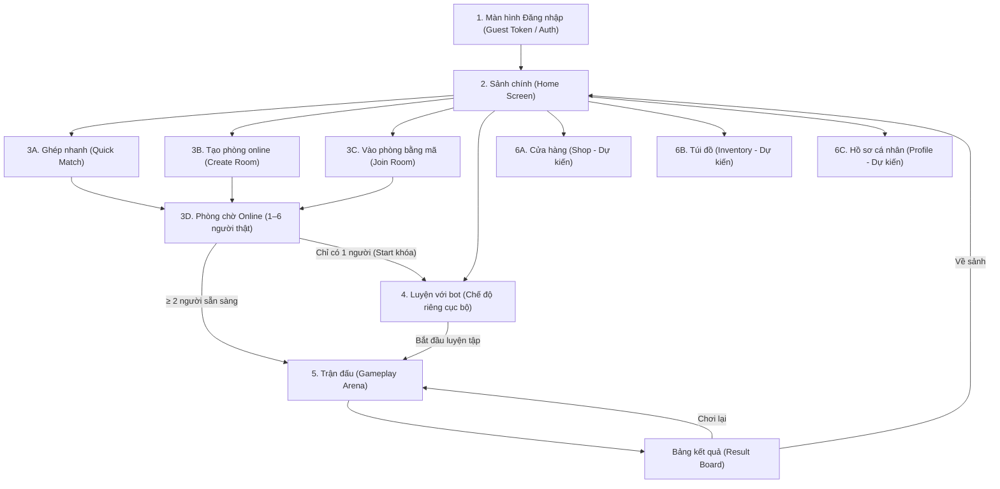

# HIT ME – THIẾT KẾ RÀ SOÁT PHASE 3 BƯỚC 0 (PHASE3_STEP0.md)

> **Mục tiêu**: Rà soát kiến trúc toàn diện luồng màn hình, hợp đồng dữ liệu mạng với Server Codex (`server/README.md`), kiểm kê tài nguyên giao diện từ `ASSET HITME FINAL\HITME_UI_KIT_CLEAN` và tổng hợp các câu hỏi mở thiết kế trước khi bắt đầu lập trình Phase 3.  
> **Nguyên tắc**: Tuyệt đối không thay đổi mã nguồn gameplay hoặc mạng trong bước này.

---

## 1. DANH SÁCH MÀN HÌNH THEO LUỒNG NGƯỜI DÙNG

---

## 2. CHI TIẾT TỪNG MÀN HÌNH & ĐỐI CHIẾU GIAO THỨC SERVER CODEX

### Màn hình 1: Đăng nhập (Guest Token / Login)
- **Mục đích**: Nhập tên hiển thị của người chơi, xin cấp hoặc định danh `guest:<tên>` để lấy phiên kết nối WebSocket.
- **Hợp đồng dữ liệu với Server**:
  - Gửi: `join` kèm payload `token: "guest:<tên>"`.
  - Nhận: Server xác thực và phản hồi phiên hợp lệ. Nếu thiếu token trả mã lỗi `auth_required_use_join_token`; nếu token sai trả `auth_invalid`.
  - Client tuyệt đối không tự bịa `playerId` (server tự cấp ID khách).
- **Tài nguyên UI KIT Clean (`ASSET HITME FINAL\HITME_UI_KIT_CLEAN`)**:
  - Khung nhập liệu: `ui_input_box_cyan.png`.
  - Nút bấm: `ui_btn_cta_green.png` ("VÀO GAME").
  - Nền panel: `ui_panel_dark_gold.png`.
- **Tài nguyên còn thiếu**:
  - Logo chính thức vector hoặc chữ nghệ thuật "HIT ME" độ phân giải cao.

---

### Màn hình 2: Sảnh chính (Home Screen)
- **Mục đích**: Cửa ngõ trung tâm điều hướng người chơi vào các chế độ: Ghép nhanh, Tạo phòng, Vào phòng, Luyện với bot, và các tính năng phụ trợ.
- **Hợp đồng dữ liệu với Server**:
  - `GET /healthz`: Kiểm tra trạng thái sống của Server.
  - WebSocket kết nối giữ ấm (Keep-alive định kỳ 30 giây).
- **Tài nguyên UI KIT Clean**:
  - Banner tiêu đề: `ui_banner_wood.png`.
  - Nút Ghép Nhanh: `ui_btn_cta_yellow.png`.
  - Nút Tạo Phòng: `ui_btn_cta_blue.png`.
  - Nút Vào Phòng: `ui_btn_cta_green.png`.
  - Nút Luyện Với Bot: `ui_btn_cta_red.png`.
- **Tài nguyên còn thiếu**:
  - Icon tiền vàng (Gold) và ngọc (Gems) trên thanh trạng thái đỉnh.

---

### Màn hình 3: Phòng Online (Tạo phòng, Vào bằng mã, Phòng chờ 1–6 người)
- **Mục đích**: Phòng thi đấu mạng giữa **người thật với nhau**. Tuyệt đối **không có bot trong phòng online**.
- **Quy tắc thi đấu v1.3**:
  1. Chứa tối đa 6 người thật.
  2. Bắt đầu khi có $\ge 2$ người thật sẵn sàng (đếm ngược 3 giây).
  3. Khi chỉ có 1 người: Nút "Bắt đầu" bị khóa cứng, hiển thị câu thông báo: *"Cần ít nhất 2 người. Muốn chơi một mình, hãy sang menu Luyện với bot."* kèm nút một chạm chuyển sang màn Luyện với bot.
  4. Các ô trống hiển thị dòng chữ *"Đang chờ..."* (mặc định 6 ô).
  5. Ghép nhanh (Quick Match): Nếu sau 30 giây (`quickMatchHintSeconds = 30`) chưa tìm thấy đối thủ, server gửi `quick_match_hint` (`no_opponent_yet`) để gợi ý người chơi sang Luyện với bot, **không tự động chèn bot**.
- **Hợp đồng dữ liệu với Server (đối chiếu `server/README.md`)**:
  - Client gửi:
    + `room_ready`: Báo trạng thái sẵn sàng trong phòng chờ.
    + `start`: Host yêu cầu bắt đầu ngay (chỉ hoạt động khi $\ge 2$ người).
    + `leave`: Rời phòng hoặc hủy hàng chờ ghép nhanh.
  - Server trả:
    + `room_state`: Chứa danh sách `players` (ID, tên, trạng thái ready), `maxPlayers: 6`, `minPlayersToStart: 2`.
    + `error` với mã `not_enough_players`: Khi phòng chỉ có 1 người mà cố tình bấm bắt đầu.
    + `quick_match_waiting`: Báo hiệu đang trong hàng chờ ghép nhanh.
    + `quick_match_hint`: Gợi ý chơi với bot khi quá 30 giây.
    + `round_start`: Khi đủ $\ge 2$ người sẵn sàng và đếm ngược 3 giây kết thúc.
- **Tài nguyên UI KIT Clean**:
  - Khung thẻ người chơi: `ui_card_char_normal.png`, `ui_card_char_selected.png`.
  - Nút sẵn sàng: `ui_btn_cta_green.png`.
  - Nút rời phòng: `ui_btn_circle_back.png`.
  - Toggle cài đặt: `ui_toggle_on.png`, `ui_toggle_off.png`.
- **Tài nguyên còn thiếu**:
  - Icon vương miện (Crown) đánh dấu chủ phòng (Host).

---

### Màn hình 4: Luyện với Bot (Chế độ riêng biệt ở Menu)
- **Mục đích**: Chế độ chơi đơn ngoại tuyến hoặc tập luyện cục bộ trên máy, **hoàn toàn không kết nối server hay mạng**.
- **Quy tắc thi đấu**:
  1. Người chơi tùy chọn số lượng bot: 1 đến 5 bot (mặc định 3 bot $\rightarrow$ tổng 4 người chơi).
  2. Người chơi chọn 1 trong 7 nhân vật yêu thích.
  3. Trận đấu vận hành 100% bằng mã nguồn thuần `Core/Phase1` và `LocalBot` (`Phase1BotBrain`).
  4. Tuân thủ tuyệt đối luật v1.2: 3 HP, 5 giây đặt vị trí bí mật, ném đồng thời, hướng mặc định `ThrowFacing` khi không ngắm.
- **Hợp đồng dữ liệu với Server**: **Không có** (Không gửi bất kỳ gói tin mạng nào).
- **Tài nguyên UI KIT Clean**:
  - Nền panel: `ui_panel_dark_gold.png`.
  - Thanh chọn / slider số bot: `ui_slider_track.png`, `ui_slider_track_fill.png`, `ui_slider_knob.png`.
  - Thẻ chọn nhân vật: `ui_card_char_normal.png`, `ui_card_char_selected.png`.
  - Nút Bắt đầu luyện tập: `ui_btn_cta_green.png`.
  - Nút Quay lại sảnh: `ui_btn_circle_back.png`.

---

### Màn hình 5: Trận đấu Gameplay (Placing, Reveal, Throwing, Result)
- **Mục đích**: Vòng lặp trận đấu chính theo chuẩn Portrait Mobile 1080×2340 và SafeArea.
- **Hợp đồng dữ liệu với Server (Khi chơi Online)**:
  - Client gửi:
    + `commit`: `{"v":1,"type":"commit","roundId":1,"positionX":...,"positionY":...,"aimX":...,"aimY":...}`.
    + `lock_ready`: Khóa sớm pha đặt dép khi người chơi bấm nút Khóa.
    + `emote`: Gửi biểu cảm (bảo mật không lộ vị trí).
  - Server trả:
    + `reveal`: Công bố vị trí và hướng ngắm của toàn bộ người chơi khi hết 5 giây đặt.
    + `round_result`: Kết quả va chạm, lượng sát thương, HP còn lại của từng người, người bị loại.
    + `match_end`: Xếp hạng chung cuộc, danh sách người thắng cuộc (`winners`).
- **Tài nguyên UI KIT Clean**:
  - Thẻ HP người chơi: Thiết kế động 1–2 hàng phía trên rào chắn (`N=2,3` 1 hàng; `N=4,5,6` 2 hàng đối xứng).
  - Bảng xếp hạng kết quả: `ui_row_leaderboard.png`, `ui_row_leaderboard_me.png` (dòng của bản thân).
  - Nút Chơi lại: `ui_btn_cta_yellow.png`.
  - Nút Về sảnh: `ui_btn_cta_blue.png`.

---

### Màn hình 6: Cửa hàng, Túi đồ, Hồ sơ (Shop, Inventory, Profile - Dự kiến)
- **Mục đích**: Các tính năng mở rộng meta-game casual (chọn skin dép, trang phục nhân vật, xem lịch sử đấu).
- **Tài nguyên UI KIT Clean**:
  - Panel nền: `ui_panel_dark_gold.png`.
  - Khung vật phẩm: `ui_card_char_normal.png`.
  - Nút mua / trang bị: `ui_btn_cta_green.png`, `ui_btn_cta_yellow.png`.
- **Tài nguyên còn thiếu**:
  - Icon các loại dép (Sandal, Dép tổ ong, Guốc gỗ, Giày tây...).
  - Huy hiệu xếp hạng (Rank badges).

---

## 3. CÂU HỎI MỞ CẦN CHỦ DỰ ÁN QUYẾT ĐỊNH TRƯỚC KHI LẬP TRÌNH PHASE 3

1. **Phần thưởng & Thành tích chế độ Luyện với bot**:
   - *Câu hỏi*: Người chơi khi thắng/thua trận Luyện với bot có được nhận Vàng (Gold) hay tính vào điểm Xếp hạng/Thành tích (ELO/Rank) không?
   - *Đề xuất kỹ thuật*: Mặc định **KHÔNG** tính điểm xếp hạng và không thưởng vàng để chống cày cuốc bot offline gian lận; chỉ thưởng điểm nhiệm vụ tân thủ cơ bản (nếu có).

2. **Luật trùng nhân vật trong Phòng Online**:
   - *Câu hỏi*: Trong phòng online 6 người, nếu 2 hoặc nhiều người cùng thích chọn "Nam Làng", hệ thống sẽ xử lý thế nào?
     - *Phương án A*: Cho phép trùng nhân vật nhưng đổi bảng màu áo/nón (Palette Swap / Color Tint) và hiển thị rõ số thứ tự P1, P2...
     - *Phương án B*: Khóa độc quyền nhân vật theo nguyên tắc ai vào phòng chọn trước thì người sau phải chọn nhân vật khác.
   - *Đề xuất kỹ thuật*: Chọn **Phương án A** (cho phép chọn tự do, đánh số màu) để mang lại trải nghiệm casual thoải mái nhất cho người chơi.

3. **Cơ chế chuyển quyền Chủ phòng (Host Migration)**:
   - *Câu hỏi*: Khi Host tạo phòng nhưng bất ngờ thoát phòng trước khi trận đấu bắt đầu, phòng sẽ bị hủy hay tự động chuyển quyền Host cho người có mặt lâu thứ hai trong phòng?
   - *Đề xuất kỹ thuật*: Tự động chuyển quyền Host cho người chơi ở Slot tiếp theo để các thành viên khác không bị mất phòng.

4. **Xử lý Server Render miễn phí ngủ đông sau 15 phút**:
   - *Câu hỏi*: Server backend của Codex trên nền tảng Render miễn phí sẽ rơi vào trạng thái ngủ đông (Sleep) nếu sau 15 phút không có truy cập, dẫn đến việc người chơi đầu tiên kết nối có thể bị trễ 30–50 giây khởi động lại WebSocket.
   - *Lựa chọn của chủ dự án*:
     - *Lựa chọn 1*: Nâng cấp gói trả phí của Render ($7/tháng) để máy chủ chạy 24/7 không gián đoạn.
     - *Lựa chọn 2*: Cài đặt bot tự động gửi lệnh ping giữ ấm (Keep-alive ping) mỗi 10 phút một lần.
     - *Lựa chọn 3*: Chấp nhận hành vi này trong giai đoạn thử nghiệm nội bộ.
