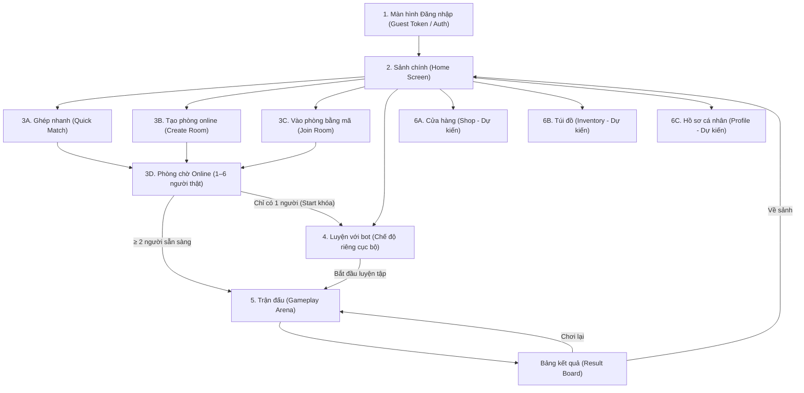

# HIT ME – THIẾT KẾ RÀ SOÁT PHASE 3 BƯỚC 0 (PHASE3_STEP0.md)

> **Mục tiêu**: Rà soát kiến trúc toàn diện luồng màn hình, hợp đồng dữ liệu mạng với Server Codex (`server/README.md`), kiểm kê tài nguyên giao diện từ `ASSET HITME FINAL\HITME_UI_KIT_CLEAN` và tổng hợp các câu hỏi mở thiết kế trước khi bắt đầu lập trình Phase 3.  
> **Nguyên tắc**: Tuyệt đối không thay đổi mã nguồn gameplay hoặc mạng trong bước này.

---

## 1. DANH SÁCH MÀN HÌNH THEO LUỒNG NGƯỜI DÙNG

---

## 2. CHI TIẾT TỪNG MÀN HÌNH & BẢNG ÁNH XẠ GIAO THỨC SERVER THẬT (`server/README.md`)

> **Đính chính minh bạch về giao thức**: Các tên thông điệp giả định trong các thảo luận sơ khởi trước đây (`create_room`, `place_bid`, `throw_target`, `round_resolved`...) là **sai / bịa đặt**, không có trong mã nguồn server.  
> Giao thức WebSocket có thẩm quyền duy nhất của hệ thống do **Codex** phát triển được quy định tại `server/README.md` (chuẩn JSON phiên bản `{"v": 1, "type": "..."}`).

### Bảng Ánh Xạ Toàn Diện Giao Thức WebSocket Client ↔ Server

| STT | Tên Message | Chiều | Cấu trúc Payload & Mục đích | Trích dẫn nguồn `server/README.md` |
|:---:|:---|:---:|:---|:---|
| 1 | `join` | Client $\rightarrow$ Server | `{"v":1, "type":"join", "token":"guest:<tên>"}` Bắt buộc có `token`; server cấp ID khách; thiếu token trả `auth_required_use_join_token`, sai trả `auth_invalid`. | Dòng 5 (`server/README.md`) |
| 2 | `room_ready` | Client $\rightarrow$ Server | `{"v":1, "type":"room_ready"}` Báo sẵn sàng trong phòng chờ; khi $\ge 2$ người ready, server đếm 3 giây rồi phát `round_start`. | Dòng 5 (`server/README.md`) |
| 3 | `start` | Client $\rightarrow$ Server | `{"v":1, "type":"start"}` Host gửi để bắt đầu ngay (chỉ hoạt động khi $\ge 2$ người thật; phòng 1 người trả lỗi `not_enough_players`). | Dòng 5, 9 (`server/README.md`) |
| 4 | `lock_ready` | Client $\rightarrow$ Server | `{"v":1, "type":"lock_ready"}` Dùng riêng trong pha đặt dép để người chơi khóa vị trí và hướng sớm. | Dòng 5 (`server/README.md`) |
| 5 | `commit` | Client $\rightarrow$ Server | `{"v":1, "type":"commit", "roundId":1, "positionX":1, "positionY":2, "aimX":0, "aimY":1}` Gửi vị trí đặt và hướng ném. Server trả xác nhận riêng tư trong lúc đặt, sau khi khóa mới broadcast. Tối đa 1 KiB, 20 msg/s. | Dòng 5 (`server/README.md`) |
| 6 | `leave` | Client $\rightarrow$ Server | `{"v":1, "type":"leave"}` Rời khỏi phòng chờ hoặc rời khỏi hàng chờ ghép nhanh. | Dòng 5, 7 (`server/README.md`) |
| 7 | `quick_match` | Client $\rightarrow$ Server | `{"v":1, "type":"quick_match", "token":"guest:<tên>"}` Yêu cầu tham gia hàng chờ ghép nhanh (người 1 vào chờ, người 2 vào tạo phòng 2 người thật). | Dòng 7 (`server/README.md`) |
| 8 | `emote` | Client $\rightarrow$ Server | `{"v":1, "type":"emote", "id": "..."}` Gửi biểu cảm cảm xúc; tuân thủ quy tắc bảo mật không làm lộ vị trí đặt trong pha Placing. | Dòng 5, 11 (`server/README.md`) |
| 9 | `room_state` | Server $\rightarrow$ Client | `{"v":1, "type":"room_state", "config":{"maxPlayers":6, "minPlayersToStart":2}, "players":[...]}` Cập nhật trạng thái phòng, danh sách người chơi thật và trạng thái sẵn sàng. | Dòng 5 (`server/README.md`) |
| 10 | `round_start` | Server $\rightarrow$ Client | `{"v":1, "type":"round_start", "roundId":1}` Bắt đầu vòng đấu mới; đồng hồ 5 giây đặt bắt đầu đếm ngược. | Dòng 5, 11 (`server/README.md`) |
| 11 | `reveal` | Server $\rightarrow$ Client | `{"v":1, "type":"reveal", "players":[...]}` Công bố công khai toàn bộ vị trí đặt và hướng ném của tất cả người chơi sau khi khóa pha đặt. | Dòng 5 (`server/README.md`) |
| 12 | `round_result` | Server $\rightarrow$ Client | `{"v":1, "type":"round_result", "hits":[...], "players":[...]}` Kết quả va chạm, lượng HP bị trừ, danh sách người bị loại trong vòng đấu. | Dòng 5, 13 (`server/README.md`) |
| 13 | `match_end` | Server $\rightarrow$ Client | `{"v":1, "type":"match_end", "winners":[...], "rankings":[...]}` Kết thúc trận đấu (còn $\le 1$ người sống hoặc hết 5 vòng), công bố thứ hạng 1..N. | Dòng 5, 13 (`server/README.md`) |
| 14 | `quick_match_waiting` | Server $\rightarrow$ Client | `{"v":1, "type":"quick_match_waiting", "quickMatchHintSeconds":30}` Thông báo đang xếp hàng chờ đối thủ ghép nhanh. | Dòng 7, 9 (`server/README.md`) |
| 15 | `quick_match_hint` | Server $\rightarrow$ Client | `{"v":1, "type":"quick_match_hint", "code":"no_opponent_yet", "quickMatchHintSeconds":30}` Gợi ý sau 30s chưa có người chơi: Chơi với bot (không tự thêm bot). | Dòng 7, 9 (`server/README.md`) |
| 16 | `quick_match_left` | Server $\rightarrow$ Client | `{"v":1, "type":"quick_match_left"}` Xác nhận đã hủy hàng chờ ghép nhanh thành công. | Dòng 7 (`server/README.md`) |
| 17 | `error` | Server $\rightarrow$ Client | `{"v":1, "type":"error", "code":"not_enough_players"}` Báo lỗi nghiệp vụ (ví dụ: host cố bấm bắt đầu phòng 1 người, sai token, timeout...). | Dòng 5, 9 (`server/README.md`) |
| 18 | `server_shutdown` | Server $\rightarrow$ Client | `{"v":1, "type":"server_shutdown"}` Server phát khi nhận tín hiệu SIGTERM đóng kết nối an toàn. | Dòng 11 (`server/README.md`) |

---

### Màn hình 1: Đăng nhập (Guest Token / Login)
- **Mục đích**: Nhập tên hiển thị của người chơi, xin cấp hoặc định danh `guest:<tên>` để lấy phiên kết nối WebSocket (`join`).
- **Hợp đồng dữ liệu với Server**:
  - Gửi: `join` kèm payload `token: "guest:<tên>"` (Dòng 5 `server/README.md`).
  - Nhận: Server cấp ID khách. Thiếu token nhận `error: auth_required_use_join_token`; sai token nhận `error: auth_invalid`.
- **Tài nguyên UI KIT Clean (`ASSET HITME FINAL\HITME_UI_KIT_CLEAN`)**:
  - Khung nhập liệu: `ui_input_box_cyan.png`.
  - Nút bấm: `ui_btn_cta_green.png` ("VÀO GAME").
  - Nền panel: `ui_panel_dark_gold.png`.

---

### Màn hình 2: Sảnh chính (Home Screen)
- **Mục đích**: Cửa ngõ trung tâm điều hướng người chơi: Ghép nhanh, Tạo phòng, Vào phòng, Luyện với bot.
- **Hợp đồng dữ liệu với Server**:
  - `GET /healthz`: Kiểm tra trạng thái máy chủ (Dòng 3 `server/README.md`).
  - WebSocket keep-alive định kỳ 30 giây (Dòng 11 `server/README.md`).
- **Tài nguyên UI KIT Clean**:
  - Banner tiêu đề: `ui_banner_wood.png`.
  - Nút Ghép Nhanh: `ui_btn_cta_yellow.png`.
  - Nút Tạo Phòng: `ui_btn_cta_blue.png`.
  - Nút Vào Phòng: `ui_btn_cta_green.png`.
  - Nút Luyện Với Bot: `ui_btn_cta_red.png`.

---

### Màn hình 3: Phòng Online (Tạo phòng, Vào bằng mã, Phòng chờ 1–6 người)
- **Mục đích**: Phòng chờ mạng giữa **người thật với nhau**. Tuyệt đối **không có bot trong phòng online** (`hit-me-room-size-rule-v1.3.md § 1.3`).
- **Quy tắc thi đấu**:
  1. Chứa tối đa 6 người thật (`maxPlayers = 6`, `minPlayersToStart = 2`).
  2. Bắt đầu khi có $\ge 2$ người thật sẵn sàng (đếm ngược 3 giây) hoặc host gửi `start`.
  3. Khi chỉ có 1 người: Nút "Bắt đầu" bị khóa cứng, bấm cố sẽ nhận `error: not_enough_players` từ server (Dòng 9 `server/README.md`). UI hiển thị nút dẫn sang **Luyện với bot**.
  4. Các ô trống hiển thị dòng chữ *"Đang chờ..."* (mặc định 6 ô).
  5. Ghép nhanh: Nếu sau 30 giây chưa có đối thủ, server gửi `quick_match_hint` (`no_opponent_yet`) để gợi ý sang Luyện với bot, không tự chèn bot.
- **Hợp đồng dữ liệu với Server**:
  - Gửi: `room_ready`, `start`, `leave`.
  - Nhận: `room_state`, `error`, `round_start`.
- **Tài nguyên UI KIT Clean**:
  - Khung thẻ người chơi: `ui_card_char_normal.png`, `ui_card_char_selected.png`.
  - Nút sẵn sàng: `ui_btn_cta_green.png`.
  - Nút rời phòng: `ui_btn_circle_back.png`.

---

### Màn hình 4: Luyện với Bot (Chế độ riêng biệt ở Menu)
- **Mục đích**: Chế độ chơi đơn ngoại tuyến hoặc tập luyện cục bộ trên máy, **hoàn toàn không kết nối server hay mạng**.
- **Quy tắc thi đấu**:
  1. Người chơi tùy chọn số lượng bot: 1 đến 5 bot (mặc định 3 bot $\rightarrow$ tổng 4 người chơi).
  2. Người chơi chọn 1 trong 7 nhân vật yêu thích.
  3. Trận đấu vận hành 100% bằng mã nguồn thuần `Core/Phase1` và `LocalBot` (`Phase1BotBrain`).
  4. Tuân thủ tuyệt đối luật v1.2 & v1.3: 3 HP, 5 giây đặt vị trí bí mật, ném đồng thời, hướng mặc định `ThrowFacing` khi không ngắm.
- **Hợp đồng dữ liệu với Server**: **Không có** (Chạy cục bộ, không socket).
- **Tài nguyên UI KIT Clean**:
  - Nền panel: `ui_panel_dark_gold.png`.
  - Nút tăng/giảm bot: `btnDecBot`, `btnIncBot`.
  - Nút Bắt đầu luyện tập: `ui_btn_cta_green.png`.
  - Nút Quay lại sảnh: `ui_btn_circle_back.png`.

---

### Màn hình 5: Trận đấu Gameplay (Placing, Reveal, Throwing, Result)
- **Mục đích**: Vòng lặp trận đấu chính theo chuẩn Portrait Mobile 1080×2340 và SafeArea.
- **Hợp đồng dữ liệu với Server (Khi chơi Online)**:
  - Client gửi: `commit`, `lock_ready`, `emote`.
  - Server trả: `round_start`, `reveal`, `round_result`, `match_end`.
- **Tài nguyên UI KIT Clean**:
  - Thẻ HP người chơi: 1–2 hàng phía trên rào chắn (`N=2,3` 1 hàng; `N=4,5,6` 2 hàng đối xứng).
  - Bảng xếp hạng kết quả: `ui_row_leaderboard.png`, `ui_row_leaderboard_me.png`.
  - Nút Chơi lại: `ui_btn_cta_yellow.png`.
  - Nút Về sảnh: `ui_btn_cta_blue.png`.

---

### Màn hình 6: Cửa hàng, Túi đồ, Hồ sơ (Shop, Inventory, Profile - Dự kiến)
- **Mục đích**: Các tính năng mở rộng meta-game casual (chọn skin dép, xem lịch sử đấu).
- **Tài nguyên UI KIT Clean**:
  - Panel nền: `ui_panel_dark_gold.png`.
  - Khung vật phẩm: `ui_card_char_normal.png`.
  - Nút mua / trang bị: `ui_btn_cta_green.png`, `ui_btn_cta_yellow.png`.

---

## 3. CÂU HỎI MỞ CẦN CHỦ DỰ ÁN QUYẾT ĐỊNH CHO BƯỚC TIẾP THEO

> *Lưu ý*: Các câu hỏi về cơ chế cử chỉ (đã chốt theo Luật v1.2), thời gian đếm ngược (đã chốt 5 giây) và thời gian giữ chỗ ngắt kết nối (đã chốt 30 giây theo `server/README.md` dòng 11) đã được giải quyết xong, không còn là câu hỏi mở. Dưới đây là 5 câu hỏi mở thực sự cần chủ dự án định hướng:

1. **Phần thưởng & Thành tích chế độ Luyện với bot**:
   - *Câu hỏi*: Người chơi khi thắng/thua trận Luyện với bot có được nhận Vàng (Gold) hay tính vào điểm Xếp hạng/Thành tích (ELO/Rank) không?
   - *Mặc định đề xuất*: **KHÔNG** tính điểm xếp hạng và không thưởng vàng (hoặc chỉ thưởng nhiệm vụ tân thủ một lần duy nhất) để tránh gian lận cày điểm offline.

2. **Chuyển quyền Chủ phòng khi Host rời mạng (Host Migration)**:
   - *Câu hỏi*: Trong phòng chờ online, nếu người tạo phòng (Host) bấm `leave` hoặc mất kết nối thì phòng sẽ giải tán ngay lập tức hay tự động chuyển quyền Host cho người chơi vào kế tiếp?
   - *Mặc định đề xuất*: Chuyển quyền Host cho người chơi kế tiếp trong danh sách `players` để duy trì phòng chờ cho những người còn lại.

3. **Cơ chế vào phòng Online**:
   - *Câu hỏi*: Người chơi vào phòng bằng cách nhập Mã phòng 6 ký tự (Room Code), hay hệ thống hiển thị Danh sách các phòng đang mở (Lobby Browser) để chọn vào trực tiếp?

4. **Chọn đổi nhân vật trong phòng chờ**:
   - *Câu hỏi*: Sau khi đã vào phòng chờ, người chơi có được bấm đổi sang nhân vật khác trong 7 nhân vật ngay tại sảnh chờ không, hay phải thoát ra ngoài màn hình chính để chọn lại?

5. **Giải trình về khái niệm Changa (`TakeStick`)**:
   - *Giải trình*: Khái niệm Changa / `TakeStick` xuất phát từ dự thảo thiết kế cơ chế ban đầu (thử nghiệm nhặt gậy đánh phản đòn), hoàn toàn **không nằm trong Luật chơi chốt v1.2 và v1.3**.
   - *Xác nhận*: Chế độ Online chính thức và Luyện với bot chỉ sử dụng cơ chế ném dép đồng thời, 3 HP, 5 giây đặt bí mật; khái niệm Changa được xếp vào diện "ngoài phạm vi online v1.3".
